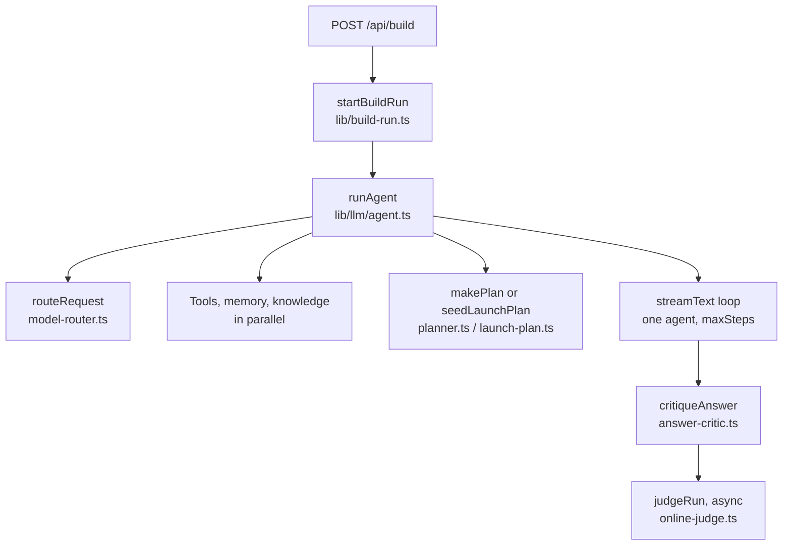
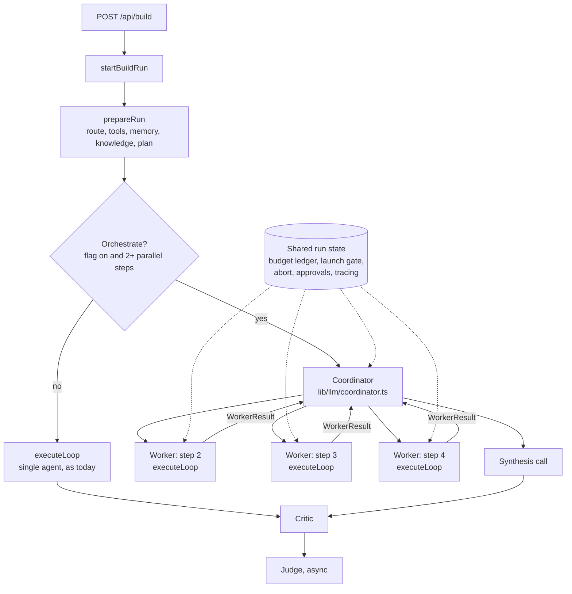
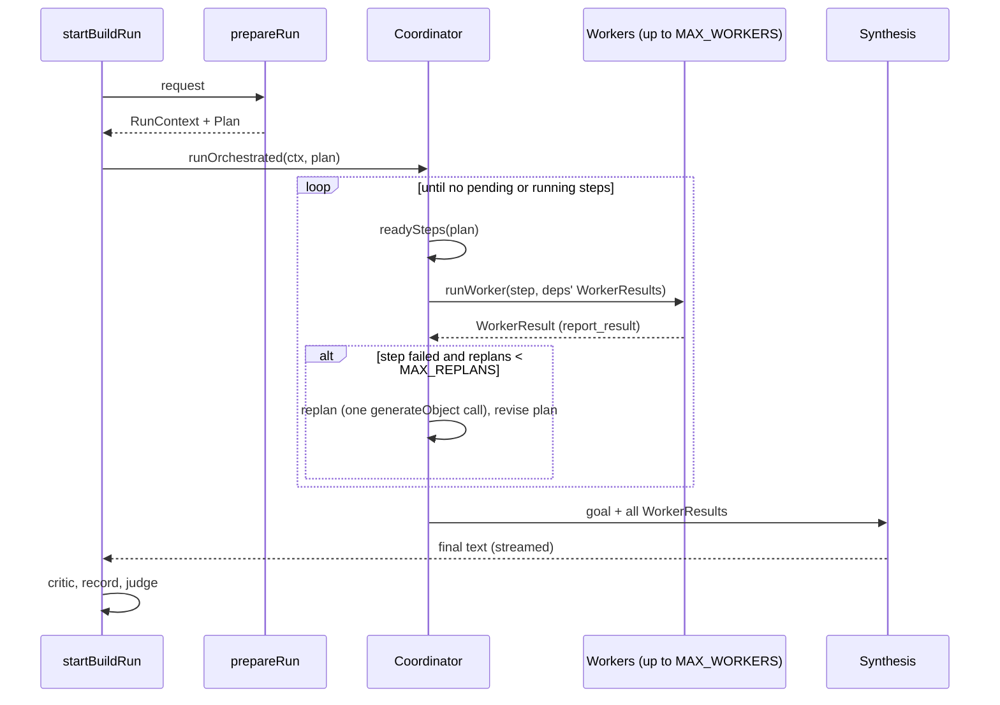

# Design Document

## Overview

Orchestration adds a coordinator between planning and the final answer.
When it is on, the coordinator runs ready plan steps as concurrent worker
agents instead of running the whole plan in one loop. Setup, the critic, the
judge and the job wrapper stay as they are.

Everything runs in the existing Node process. Workers are async calls to
`executeLoop`, not processes or containers. That matches the in-process state
the app already relies on: jobs (`lib/run-jobs.ts`), approvals
(`lib/llm/approvals.ts`) and the kill switch (`lib/kill-switch.ts`), all kept
on `globalThis` and documented as assuming one Node process.

The work is split into six phases, each its own PR. Phase 1 is a
behaviour-preserving refactor; phases 2–6 sit behind `ORCHESTRATION`.

## Architecture

### Current flow



### Target flow



### Run sequence



1. `startBuildRun` starts the job, as today.
2. `prepareRun` routes, selects tools, loads memory and knowledge, and makes
   the plan (Launch: the template). Plan approval works as today.
3. If orchestration is off, or fewer than two steps can run together,
   `executeLoop` runs the plan as a single agent, exactly as today.
4. Otherwise the coordinator marks ready steps `running` and starts one
   worker each, up to `MAX_WORKERS`.
5. Each worker runs `executeLoop` with its brief, tools and child budget, and
   ends by calling `report_result`.
6. On `done`, the coordinator stores the result and starts newly ready
   steps. On `failed`, it waits for running workers, makes one replanning
   call and continues with the revised steps.
7. When no steps remain, one synthesis call writes the final answer from all
   results. The critic, judge and run record follow as today.

## Components and Interfaces

### Phase 1: split `runAgent` (`lib/llm/agent.ts`)

`runAgent` is currently one function of about 500 lines (lines 823–1330).
The loop (`callModel` and the fallback loop) reads `tools`, `userMessage`,
`budget`, `launchGate`, `approvalReasons`, `toolApproval`, `tracer`,
`versions`, `planTracker` and the callbacks from closures.

```ts
// lib/llm/agent-core.ts (types only, no live MCP imports)
export interface LoopContext {
  tools: ToolSet;
  launchMode: boolean;
  publishEnabled: boolean;
  userMessage: string;
  modelKey: string;              // resolved start model
  isPinned: boolean;
  maxSteps: number;
  budget: BudgetHandle;          // see Phase 3; Phase 1 = a plain RunBudgetTracker factory
  toolApproval?: ToolApprovalFn;
  approvalReasons: Map<string, ApprovalReason>;
  launchGate?: LaunchValidationGate;
  abortSignal?: AbortSignal;
  thinkingBudget?: number;
  modelHealth: ModelHealthTracker;
  tracerAttrs: Record<string, AttrValue>;
  tracerParent?: SpanRef;        // Phase 3: new type in lib/tracing.ts (parent span id + trace id)
  forceFinalTool?: string;       // Phase 2: 'report_result' for workers
  onStep?: (step: AgentStepTrace) => void;
  onTextDelta?: (delta: string) => void;
  onToolOutcome?: (o: ToolOutcome) => void;
  onRestart?: (info: { fromModelKey: string; toModelKey: string }) => void;
}

export interface LoopResult {
  text: string;
  steps: AgentStepTrace[];
  finishReason: string;
  usage: TokenUsage;
  modelKey: string;
  stopReason?: BudgetStopReason;
  budgetUsage: BudgetUsage;
  hadSideEffects: boolean;
}
```

```ts
// lib/llm/agent.ts
export async function prepareRun(opts: RunAgentOptions): Promise<PreparedRun | EarlyResult>;
export async function executeLoop(ctx: LoopContext): Promise<LoopResult>;
export async function runAgent(opts: RunAgentOptions): Promise<AgentRunResult>; // unchanged signature
```

`EarlyResult` covers the existing early returns: an unclear routed request
(clarifying question) and a denied plan. `PreparedRun` carries the
`LoopContext` plus `toolsConsidered`, `plan`/`planTracker`, `route`,
`versions`, `planningRetrieval` and the RAG judgment sink, so `runAgent` can
assemble the same `AgentRunResult` as today.

`buildSystemMessage` already takes `(modelKey, toolDiscovery, memory,
launchMode, publishEnabled)` and stays as is; `executeLoop` calls it per model
attempt, as today.

### Phase 2: coordinator and workers

```ts
// lib/llm/coordinator.ts
export interface OrchestrationConfig {
  maxWorkers: number;            // min(MAX_WORKERS, request.maxWorkers)
  maxReplans: number;            // MAX_REPLANS
  workerMaxSteps: number;        // WORKER_MAX_STEPS
  workerModelKey?: string;       // WORKER_MODEL
  serialWrites: boolean;         // launchMode && !LAUNCH_PARALLEL_WRITES
}

export function orchestrationConfig(req: { maxWorkers?: number }, launchMode: boolean): OrchestrationConfig;
export function shouldOrchestrate(flag: OrchestrationFlag, requested: boolean | undefined, plan: Plan | undefined): boolean;

export async function runOrchestrated(
  prepared: PreparedRun,
  tracker: PlanTracker,
  config: OrchestrationConfig,
  hooks: { onWorker?: (w: WorkerRecord) => void; onStep?: ...; onTextDelta?: ...; ... }
): Promise<AgentRunResult>;
```

Scheduler loop (single-threaded, event-driven):

```ts
const running = new Map<number, Promise<WorkerOutcome>>();
for (;;) {
  if (aborted || ledger.exhausted()) break;
  for (const step of readySteps(tracker.plan)) {
    if (running.size >= config.maxWorkers) break;
    if (config.serialWrites && isWriteStep(step) && anyRunningWrite(running)) continue;
    running.set(step.id, startWorker(step));
  }
  if (running.size === 0) break;           // nothing ready, nothing running → done or stuck
  const outcome = await Promise.race(running.values());
  running.delete(outcome.stepId);
  applyOutcome(outcome);                   // update step, store WorkerResult, maybe replan
}
return synthesize();
```

A failed step triggers replanning only after `running` drains, so the
replan sees every finished result.

```ts
// lib/llm/worker.ts
export interface WorkerInput {
  runGoal: string;
  step: PlanStep;
  deps: WorkerResult[];
  knowledge?: string;              // planningRetrieval.context
  tools: ToolSet;                  // narrowed, see below
  modelKey: string;
  maxSteps: number;
  shared: SharedRunState;
  attempt: number;
}
export async function runWorker(input: WorkerInput): Promise<WorkerRecord>;
export function workerTools(all: ToolSet, step: PlanStep, catalog: McpToolDefinition[]): ToolSet;
export function reportResultTool(sink: (r: WorkerResult) => void): Tool;
```

Worker tools: the step's tool + every tool in the same `PLATFORM_GROUPS`
group (`lib/llm/tool-catalog.ts:84`) that is in the run's policy-filtered
tool set, + `find_tools`, `call_tool`, `report_result`. Grouping by platform
keeps the number of distinct tool sets (and so prompt-cache prefixes) per run
at 2–3.

Forcing the result: `executeLoop` gets `forceFinalTool: 'report_result'`. In
`prepareStep`, the last allowed step (or a budget wrap-up step) returns
`toolChoice: { type: 'tool', toolName: 'report_result' }` instead of
`'none'`. For history-bound models, which must not have their tool choice
changed mid-run, append the instruction "Call report_result now." instead.

Worker brief (first user message):

```
You are carrying out ONE step of a larger plan. Do only this step.

Goal of the whole run: <goal>
Your step: <description>
Tool to use: <tool>
Done when: <expectedOutput>

Results from earlier steps:
- Step <id> (<description>): <summary> ids=<json>

<planning knowledge excerpts>

When the step is done, or cannot be done, call report_result.
```

Planner changes (`lib/llm/planner.ts`):

- `PlanTracker.revise` takes `dependsOn` per new step and remaps it to the
  new ids; today it sets `dependsOn: []` (line 126).
- `revise_plan`'s input schema gains optional `dependsOn: number[]`.
- `normalisePlan` rejects cycles and unknown ids (throws; the caller falls
  back to single-agent).
- New `readySteps(plan): PlanStep[]` and `parallelWidth(plan): number` (the
  largest set of steps with no path between them; used by
  `shouldOrchestrate`).

Launch template (`lib/llm/launch-plan.ts`): set `dependsOn` so that reading
property state comes first, data-element generation depends on it, rule
generation depends on data elements, validation depends on both, and library
population (and publish, when enabled) comes last.

Synthesis: one `generateText` call on the run's model with the goal, every
step's status and `WorkerResult`, and instructions to report what was not
done. Streamed via `streamText` so `text_delta` keeps working.

### Phase 3: shared run state

```ts
// lib/llm/run-budget.ts
export class RunLedger {
  constructor(limits: RunBudgetLimits, startedAt: number);
  child(modelKey: string, share: number): RunBudgetTracker; // charges this ledger too
  exhausted(): BudgetStopReason | undefined;
  usage(): BudgetUsage;
}
```

`RunBudgetTracker` gains an optional parent; `recordStep` charges both.
`exceeded()` returns the child's or the parent's reason. Identical-call
counts stay on the child. In single-agent mode `executeLoop` gets a tracker
with no parent, so behaviour is unchanged.

```ts
// lib/llm/worker.ts
export interface SharedRunState {
  runId?: string;
  ledger: RunLedger;
  launchGate?: LaunchValidationGate;  // same instance for every worker
  abortSignal?: AbortSignal;           // the run's; each worker links a child controller
  approveTool?: RunAgentOptions['approveTool'];
  onToolOutcome?: RunAgentOptions['onToolOutcome'];
  modelHealth: ModelHealthTracker;
  tracerParent?: SpanRef;
}
```

| Concern | With workers | File |
| --- | --- | --- |
| Token / cost / time budget | One run ledger; child tracker per worker capped at `WORKER_BUDGET_SHARE` of what remains | `run-budget.ts` |
| Loop detection | Per worker | `run-budget.ts` |
| Launch validation gate | One per run, shared | `launch-validation.ts` (no API change) |
| Model fallback | Restart only the failed worker; side-effect check per worker | `agent.ts` (`executeLoop`) |
| Abort | Child `AbortController` per worker, linked to the run's | `worker.ts` |
| Approvals | Unchanged registry; events gain `workerId` | `approvals.ts`, `build-run.ts` |
| Audit | `workerId` on events | `build-run.ts` |
| Tracing | Run span → coordinator span → worker spans | `tracing.ts` |
| Read cache | Unchanged, shared across workers | `tool-call-cache.ts` |
| Memory | Coordinator only | `worker.ts` |

### Phase 4: events, record, resume

- `lib/build-run.ts`: pass `orchestrate` to `runAgent`; forward
  `worker_start`/`worker_done`; tag `step`, `approval_request`, `restart` and
  audit events with `workerId`; on a worker `restart`, drop only that
  worker's steps from the checkpoint; checkpoint after worker start/end.
- `resumeContextFrom` (`lib/build-run.ts:293`): for a version-2 record with
  `orchestrated: true`, return the plan and `WorkerResult`s so the resumed run
  starts the coordinator with `done` steps kept.
- `lib/execution-store.ts`: `CHECKPOINT_SCHEMA_VERSION = 2`. Workers are
  stored inside the existing `result` JSONB column; no DDL change.
- `app/api/build/route.ts`: accept and validate `orchestrate` and
  `maxWorkers`; return 429 when `activeJobCount() >= MAX_ACTIVE_RUNS`.

### Phase 5: limits and config

```ts
// lib/llm/agent-slots.ts
export function acquireLoopSlot(signal?: AbortSignal): Promise<() => void>; // resolves with release()
export function loopSlotStats(): { running: number; queued: number; max: number };
```

A FIFO semaphore on `globalThis` (same pattern as `run-jobs.ts`).
`executeLoop` acquires a slot before the first model call and releases it in
`finally`. An abort while queued rejects and removes the waiter.

### Phase 6: UI and evals

- `components/AgentTrace.tsx`: group steps by `workerId`; a lane per worker
  (status, model, tokens, attempt); coordinator/synthesis steps on top.
- `components/PlanView.tsx`: several `running` steps; link to worker lane.
- `app/page.tsx`: handle `worker_start`/`worker_done`; keep a map of pending
  approvals instead of a single one; per-worker restart.
- `app/results/[id]/page.tsx`: render `workers`.
- `evals/lib/scripted-tools.ts`: key responses by tool + input.
- `evals/launch.eval.ts`, `evals/agent.eval.ts`: `EVAL_ORCHESTRATE` = `off`
  (default), `on`, `both`; new fixtures under `evals/fixtures/`.
- `evals/baseline.json`, `scripts/check-eval-baseline.mjs`: separate keys for
  orchestrated results.

## Data Models

### New types (`lib/types.ts`)

```ts
export type WorkerStatus = 'queued' | 'running' | 'done' | 'failed' | 'cancelled';

export interface WorkerResult {
  stepId: number;
  status: 'done' | 'failed';
  summary: string;               // ≤ 1,000 chars
  ids: Record<string, string>;   // e.g. { dataElementId: 'DE123' }
  notes?: string;                // ≤ 500 chars
}

export interface WorkerRecord {
  workerId: string;              // `${runId}:w${stepId}:${attempt}`
  stepId: number;
  attempt: number;
  modelKey: string;
  status: WorkerStatus;
  steps: AgentStepDTO[];
  result?: WorkerResult;
  budgetUsage: BudgetUsage;
  startedAt: string;
  durationMs?: number;
  error?: string;
}
```

### Changed types

| Type | Change |
| --- | --- |
| `BuildRequest` | `orchestrate?: boolean`; `maxWorkers?: number` |
| `AgentStepDTO` | `workerId?: string` |
| `BuildResponse`, `AgentRunResult` | `workers?: WorkerRecord[]`; `orchestrated?: boolean`; `replans?: number` |
| `PlanStep` | `workerId?: string`; `dependsOn` kept on revision |
| `RunAgentOptions` | `orchestrate?: boolean`; `maxWorkers?: number`; `onWorker?: (w: WorkerRecord) => void` |
| `BuildStreamEvent` | new `worker_start`, `worker_done`; `workerId?` on `step`, `approval_request`, `restart` |

### Configuration

| Variable | Default | Meaning |
| --- | --- | --- |
| `ORCHESTRATION` | `off` | `off` / `on` (per request) / `always` |
| `MAX_WORKERS` | `3` | Concurrent workers per run |
| `WORKER_MAX_STEPS` | `6` | Step cap per worker |
| `WORKER_BUDGET_SHARE` | `0.5` | Max share of remaining run budget per worker |
| `MAX_REPLANS` | `2` | Replanning calls per run |
| `MAX_AGENT_LOOPS` | `12` | Concurrent agent loops per process |
| `MAX_ACTIVE_RUNS` | `6` | Active runs before 429 |
| `WORKER_MODEL` | run's model | Optional model for workers |
| `LAUNCH_PARALLEL_WRITES` | `false` | Allow concurrent write workers in Launch runs |

Document all of them in `.env.local.example` and `ENVIRONMENT_VARIABLES.md`.

## Error Handling

| Situation | Behaviour |
| --- | --- |
| Plan has a cycle or unknown `dependsOn` | Log a warning, run single-agent |
| Worker ends without `report_result` | Step `failed`, error "worker ended without a result" |
| Worker provider failure, no side effects | Restart that worker on a same-tier model; `restart` event with `workerId` |
| Worker provider failure after a write | Step `failed`; no restart |
| Worker throws anything else | Step `failed` with the error message |
| Replanning call fails | Skip remaining steps; synthesis reports them |
| Run ledger exhausted | No new workers; running ones get the wrap-up step; `stopReason` set |
| Run cancelled / kill switch | All worker controllers abort; queued slots released; record `cancelled` |
| Synthesis call fails | Fall back to a plain list of step summaries as the final text, with `finishReason: 'error'` |
| No loop slot free | Worker waits in the FIFO queue; abort removes it |

## Testing Strategy

Unit tests (vitest, `npm test`):

| File | Covers |
| --- | --- |
| `lib/llm/agent.test.ts` (existing) | Phase 1 changes nothing |
| `lib/llm/coordinator.test.ts` (new) | Ready-step scheduling; `MAX_WORKERS`; serial writes; results to dependants; replan cap; synthesis input |
| `lib/llm/worker.test.ts` (new) | Tool narrowing; forced `report_result`; missing result; per-worker fallback; no restart after a write |
| `lib/llm/planner.test.ts` (existing) | `revise` keeps `dependsOn`; cycle rejection; `readySteps`; `parallelWidth` |
| `lib/llm/run-budget.test.ts` (existing) | Child charges parent; ledger exhaustion |
| `lib/llm/agent-slots.test.ts` (new) | FIFO order; release on error and abort |
| `lib/build-run.test.ts`, `app/api/build/route.test.ts` (existing) | Worker events; per-worker restart; 429; resume |
| `lib/kill-switch.test.ts` (existing) | Trip aborts all workers |

Concurrency tests use scripted tools with controlled delays (promises
resolved by the test) to assert which steps overlap, not wall-clock timing.

Evals: see Requirement 16. Load test before choosing the instance size: 5
concurrent orchestrated Launch runs against a staging MCP endpoint, recording
peak RSS, event-loop lag, provider 429s and MCP errors.

CI (`.github/workflows/ci.yml`) already runs typecheck, lint, unit tests and
build on every PR; every phase must pass it.

## Deployment

No deployment change. Same Dockerfile, `compose.yaml` and single container on
the same EC2 instance. Recommended: move from `t3.micro` to at least
`t3.small` (`t3.medium` for 3+ workers per run with several concurrent runs),
confirmed by the load test. Check the model provider's rate limits and the
AEC MCP server's capacity against `MAX_AGENT_LOOPS`.

Out of scope: multiple instances (needs a shared store for jobs, approvals
and the kill switch) and runs that survive a redeploy (needs a job queue).
